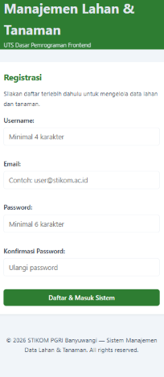
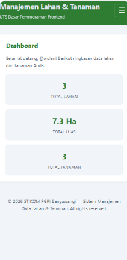
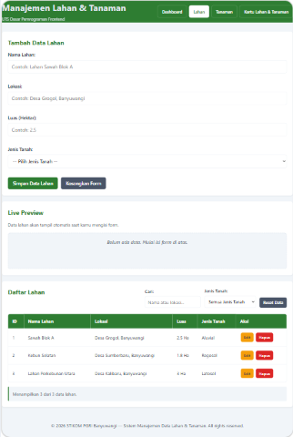
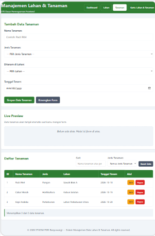
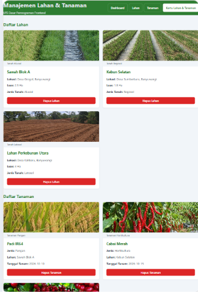

# 🌱 Sistem Manajemen Data Lahan dan Tanaman

## 📖 Deskripsi Project

**Sistem Manajemen Data Lahan dan Tanaman** adalah aplikasi web sederhana yang digunakan untuk mengelola data lahan dan tanaman. Aplikasi ini dibuat sebagai project pembelajaran untuk menerapkan konsep dasar pemrograman frontend menggunakan HTML, CSS, dan JavaScript.

Aplikasi menggunakan konsep **JavaScript Modular** dengan pemisahan kode berdasarkan tugas masing-masing modul. Data lahan dan tanaman disimpan menggunakan **localStorage**, sedangkan data pengguna yang melakukan registrasi disimpan menggunakan **sessionStorage**.

---

## ✨ Fitur Utama

### 👤 Registrasi Pengguna

Pengguna harus melakukan registrasi sebelum dapat mengakses halaman utama aplikasi.

Validasi registrasi meliputi:

- Username minimal 4 karakter.
- Format email harus valid.
- Password minimal 6 karakter.
- Konfirmasi password harus sama dengan password.

Setelah registrasi berhasil, pengguna akan diarahkan ke halaman dashboard.

### 📊 Dashboard

Halaman dashboard menampilkan ringkasan data aplikasi, yaitu:

- Total jumlah data lahan.
- Total luas seluruh lahan.
- Total jumlah data tanaman.
- Pesan selamat datang untuk pengguna yang sedang aktif.

### 🌾 Manajemen Data Lahan

Fitur pengelolaan data lahan meliputi:

- Menambah data lahan.
- Mengubah data lahan.
- Menghapus data lahan.
- Mencari data berdasarkan nama atau lokasi.
- Memfilter data berdasarkan jenis tanah.
- Menampilkan preview data secara langsung.
- Mereset data ke dataset awal.

Untuk menjaga hubungan antar data, lahan tidak dapat dihapus apabila masih digunakan oleh data tanaman.

### 🌱 Manajemen Data Tanaman

Fitur pengelolaan data tanaman meliputi:

- Menambah data tanaman.
- Mengubah data tanaman.
- Menghapus data tanaman.
- Mencari data tanaman.
- Memfilter data berdasarkan jenis tanaman.
- Menampilkan preview data secara langsung.
- Mereset data ke dataset awal.

Sistem juga mencegah data tanaman dengan nama yang sama didaftarkan lebih dari satu kali pada lahan yang sama.

### 🗂️ Tampilan Kartu

Data lahan dan tanaman dapat ditampilkan dalam bentuk kartu yang berisi:

- Gambar ilustrasi.
- Informasi data.
- Tombol hapus.
- Animasi saat data dihapus.

---

# 🖼️ Tampilan Antarmuka

## Halaman Registrasi

## Halaman Dashboard

## Halaman Data Lahan

## Halaman Data Tanaman

## Halaman Kartu

---

# 💻 Teknologi yang Digunakan

Project ini dibangun menggunakan:

- **HTML5** sebagai struktur halaman web.
- **CSS3** sebagai pengatur tampilan dan desain antarmuka.
- **JavaScript** untuk logika dan interaksi aplikasi.
- **JavaScript ES6 Modules** untuk memisahkan kode ke dalam beberapa modul.
- **Web Storage API** untuk penyimpanan data pada browser.

---

# 📂 Struktur Project
app/
│
├── index.html
├── dashboard.html
├── data-lahan.html
├── data-tanaman.html
├── card.html
│
├── assets/
│   ├── img/
│   └── screenshots/
│       ├── registrasi.png
│       ├── dashboard.png
│       ├── data-lahan.png
│       ├── data-tanaman.png
│       └── kartu.png
│
├── css/
│   └── style.css
│
├── js/
│   ├── main.js
│   └── modules/
│       ├── services.js
│       ├── validator.js
│       └── ui_renderer.js
│
├── .gitignore
└── README.md

# 🧩 Penjelasan Modul JavaScript

## `services.js`

Modul ini bertugas untuk mengelola data aplikasi, antara lain:

- Menyediakan dataset awal lahan dan tanaman.
- Memuat data dari `localStorage`.
- Menyimpan data ke `localStorage`.
- Mereset data ke dataset awal.
- Mencari dan menghapus data berdasarkan ID.
- Melakukan pencarian dan filter data.
- Menghitung total luas lahan.
- Menyimpan dan mengambil data pengguna menggunakan `sessionStorage`.

## `validator.js`

Modul ini digunakan untuk melakukan validasi data sebelum disimpan.

Validasi yang tersedia meliputi:

- Validasi data lahan.
- Validasi data tanaman.
- Validasi data registrasi pengguna.
- Validasi data duplikat.
- Pengambilan pesan kesalahan pertama.

## `ui_renderer.js`

Modul ini bertugas untuk mengatur tampilan dan manipulasi DOM, antara lain:

- Menampilkan pesan feedback.
- Menampilkan status validasi form.
- Menampilkan preview data.
- Merender tabel data lahan.
- Merender tabel data tanaman.
- Merender kartu lahan dan tanaman.
- Mengatur mode tambah dan edit.
- Menampilkan informasi dashboard.

## `main.js`

File utama yang menghubungkan seluruh modul aplikasi dan menangani:

- Inisialisasi halaman.
- Registrasi pengguna.
- Pengelolaan data lahan.
- Pengelolaan data tanaman.
- Event listener dan event delegation.
- Pencarian dan filter.
- Reset data.
- Pengaturan navigasi.
- Penjagaan akses halaman.

---

# 💾 Penyimpanan Data

Aplikasi menggunakan **Web Storage API** untuk menyimpan data pada browser.

## localStorage

Digunakan untuk menyimpan:

- Data lahan dengan key `utsDataLahan`.
- Data tanaman dengan key `utsDataTanaman`.

Data akan tetap tersimpan meskipun browser ditutup.

## sessionStorage

Digunakan untuk menyimpan informasi pengguna yang telah melakukan registrasi dengan key `utsRegisteredUser`.

Data pengguna digunakan untuk menjaga akses pengguna selama sesi browser berlangsung.

---

# 🌾 Dataset Awal

Aplikasi menyediakan beberapa data awal untuk mempermudah penggunaan dan pengujian aplikasi.

### Data Lahan

| ID | Nama Lahan | Lokasi | Luas | Jenis Tanah |
|----|------------|---------|------|-------------|
| 1 | Sawah Blok A | Desa Grogol, Banyuwangi | 2.5 Ha | Aluvial |
| 2 | Kebun Selatan | Desa Sumberbaru, Banyuwangi | 1.8 Ha | Regosol |
| 3 | Lahan Perkebunan Utara | Desa Kalibaru, Banyuwangi | 3 Ha | Latosol |

### Data Tanaman

| ID | Nama Tanaman | Jenis | Lahan | Tanggal Tanam |
|----|--------------|-------|-------|---------------|
| 1 | Padi IR64 | Pangan | Sawah Blok A | 10 Oktober 2026 |
| 2 | Cabai Merah | Hortikultura | Kebun Selatan | 15 Oktober 2026 |
| 3 | Kopi Arabika | Perkebunan | Lahan Perkebunan Utara | 20 Oktober 2026 |

---

# 🚀 Cara Menjalankan Project

1. Download atau clone repository project ini.
2. Buka folder project menggunakan **Visual Studio Code**.
3. Jalankan aplikasi menggunakan **Live Server** atau web server lokal.
4. Buka halaman `index.html`.
5. Lakukan registrasi pengguna.
6. Setelah registrasi berhasil, pengguna akan masuk ke halaman dashboard.
7. Gunakan menu navigasi untuk mengakses fitur pengelolaan data lahan dan tanaman.

> **Catatan:** Karena project menggunakan JavaScript Modules (`import` dan `export`), aplikasi disarankan dijalankan menggunakan Live Server atau web server lokal.

---

# 📚 Konsep JavaScript yang Diterapkan

Beberapa konsep JavaScript yang digunakan dalam project ini adalah:

- JavaScript ES6 Modules (`import` dan `export`).
- Arrow Function.
- Array Methods:
  - `map()`
  - `filter()`
  - `find()`
  - `some()`
  - `reduce()`
- DOM Manipulation.
- Event Listener.
- Event Delegation.
- Form Validation.
- Regular Expression (Regex).
- Template Literals.
- Spread Operator.
- Web Storage API.
- Conditional Rendering.
 